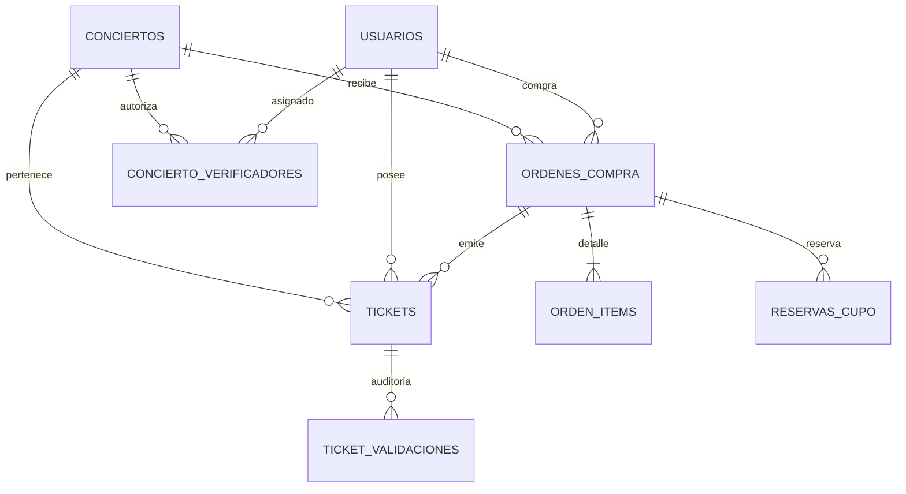

# INFORME TÉCNICO DE IMPLEMENTACIÓN — CU20 + CU21 + CU22
## SONIC LEDGER — SPRINT 3, DÍAS 4 Y 5: Comprar Entradas, Emitir Tickets QR y Validar Ingreso

---

### 1. Resumen Ejecutivo

En este bloque se implementó conjuntamente la arquitectura transaccional de ticketing, emisión de entradas digitales con código QR y validación de accesos en puerta para Sonic Ledger, cubriendo:

- **CU20 — Comprar entradas**:
  - Selección de categoría y cantidad con cálculo estricto de precios y subtotales en el backend (moneda bolivianos `BOB`).
  - Bloqueo transaccional de cupos con reservas temporales (15 minutos) usando PostgreSQL con bloqueo pesimista (`FOR UPDATE`), previniendo sobreventa bajo concurrencia extrema.
  - Pasarela simulada `MockPaymentProvider` desacoplada mediante interfaz `IPaymentProvider` para admitir a futuro WizPay u otros proveedores, con soporte para simulación de pagos aprobados, rechazados y pendientes, y la leyenda obligatoria: `PAGO DE PRUEBA — NO SE REALIZA NINGÚN COBRO REAL`.
  - Mecanismo de idempotencia con clave de operación única (`operacionId`) para evitar órdenes duplicadas ante doble clic o reintentos de red.
  - Tarea periódica de limpieza y liberación automática de cupos expirados no confirmados.

- **CU21 — Consultar entradas y mostrar QR**:
  - Pantallas de "Mis entradas" tanto en frontend Web como en Mobile (React Native / Expo).
  - Emisión de un ticket digital individual por cada entrada comprada, con código público visible (ej. `SL-TK-XXXXXX`) y token QR criptográfico opaco aleatorio de 64 caracteres hexadecimales (`SLQR_...`) no predecible.
  - Generación de código QR en base64 Data URL del lado del backend (mediante librería `qrcode`), visualizado en modales centrados de alto contraste sobre fondo blanco limpio, sin logos decorativos ni marcas de agua sobrepuestas que obstaculicen la lectura óptica.

- **CU22 — Validar ingreso mediante QR**:
  - Pantalla dedicada y protegida para usuarios con rol `VERIFICADOR` (y `ADMIN`).
  - Asignación explícita de verificadores a conciertos específicos (`concierto_verificadores`) gestionada por el organizador.
  - Escaneo óptico con cámara nativa mediante `expo-camera` (`CameraView`) y entrada manual alternativa para contingencias o pruebas.
  - Validación atómica en base de datos con bloqueo pesimista sobre el ticket que garantiza que dos verificadores escaneando simultáneamente el mismo código QR nunca permitan un doble ingreso (uno obtiene `EXITOSO` y el segundo `YA_UTILIZADO`).
  - Registro de auditoría de cada intento de validación en la tabla `ticket_validaciones`.
  - Retroalimentación visual inmediata con estados: `EXITOSO` (verde), `YA_UTILIZADO` (naranja/rojo con timestamp previo), `EVENTO_INCORRECTO` (amarillo), `INVALIDADO` (rojo) y `NO_AUTORIZADO` (rojo).

---

### 2. Archivos Creados y Modificados

#### Base de Datos y Backend (`backend/`)
- **Migración incremental**:
  - `backend/src/migrations/1794491000000-TicketingYValidaciones.ts`: creación de tablas `ordenes_compra`, `orden_items`, `reservas_cupo`, `tickets`, `concierto_verificadores`, `ticket_validaciones` e índices en claves foráneas, estados y tokens QR.
- **Entidades TypeORM**:
  - `backend/src/ticketing/orden-compra.entity.ts`: orden de compra con estados (`PENDIENTE`, `CONFIRMADA`, `EXPIRADA`, `CANCELADA`, `FALLIDA`), timestamps y expiración.
  - `backend/src/ticketing/orden-item.entity.ts`: detalle de ítems de compra con precio unitario congelado.
  - `backend/src/ticketing/reserva-cupo.entity.ts`: reserva temporal con timestamp `expiraEn` y estado (`ACTIVA`, `LIBERADA`, `CONFIRMADA`).
  - `backend/src/ticketing/ticket.entity.ts`: ticket individual con estado (`VIGENTE`, `UTILIZADO`, `INVALIDADO`), código público y token QR criptográfico.
  - `backend/src/ticketing/concierto-verificador.entity.ts`: tabla relacional de asignación de verificadores autorizados por concierto.
  - `backend/src/ticketing/ticket-validacion.entity.ts`: log de validaciones de acceso para auditoría.
- **Pasarela de Pagos**:
  - `backend/src/ticketing/payment-provider.interface.ts`: interfaz desacoplada `IPaymentProvider`, `PaymentRequest`, `PaymentResponse`.
  - `backend/src/ticketing/mock-payment.provider.ts`: implementación simulada con logging explícito de prueba sin dinero real.
- **Lógica de Negocio y Controladores**:
  - `backend/src/ticketing/ticketing.dto.ts`: DTOs validados con class-validator (`CrearOrdenDto`, `ProcesarPagoDto`, `ValidarQRDto`, `AsignarVerificadorDto`).
  - `backend/src/ticketing/ticketing.service.ts`: servicio central de compra, reservas, emisión QR, validación atómica y liberación de reservas expiradas.
  - `backend/src/ticketing/ticketing.controller.ts`: API endpoints protegidos con `JwtGuard` y `RolesGuard`.
  - `backend/src/ticketing/ticketing.module.ts`: módulo NestJS registrado en la aplicación.
- **Pruebas Automatizadas**:
  - `backend/src/ticketing/ticketing.spec.ts`: suite unitaria con 19 pruebas que verifican reglas de venta, cupos, idempotencia, estados de pago y validaciones.
  - `backend/src/ticketing/concurrency.e2e.spec.ts`: 2 pruebas reales contra PostgreSQL en contenedor Docker, comprobando prevención de sobreventa y prevención de doble validación concurrente.
- **Configuración y Registro**:
  - `backend/src/data-source.ts`: registro de las 6 entidades y migración `TicketingYValidaciones1794491000000`.
  - `backend/src/app.module.ts`: registro de `TicketingModule`.

#### Contratos Compartidos (`shared/`)
- `shared/ticketing.ts`: interfaces TypeScript unificadas para ordenes, tickets, validaciones, verificadores y payloads.
- `shared/ticketing-api.ts`: cliente HTTP tipado reutilizable por Web y Mobile (`crearReservaOrden`, `obtenerOrden`, `procesarPagoPrueba`, `listarMisTickets`, `obtenerDetalleTicket`, `validarIngresoQR`, `listarConciertosAsignadosVerificador`, `asignarVerificadorConcierto`).

#### Frontend Web (`frontend/`)
- `frontend/src/ConcertDetail.tsx`: integración del selector de categoría, cantidad (1-10), modal de checkout con temporizador de 15 minutos, simulación de pago aprobado/rechazado/pendiente y aviso de prueba.
- `frontend/src/ConcertDetail.css`: estilos para selector de cupos y modal de compra.
- `frontend/src/MyTickets.tsx`: pantalla "Mis Entradas" con catálogo de tickets digitales, badge de validez y modal centrado de QR en alto contraste.
- `frontend/src/MyTickets.css`: hoja de estilos neón para tarjetas de ticket y contenedor QR.
- `frontend/src/Concerts.tsx`: adición del enlace "Mis entradas" en la barra de navegación para usuarios autenticados.
- `frontend/src/App.tsx`: registro de ruta `/mis-entradas` -> `<MyTicketsPage />`.

#### Mobile React Native / Expo (`mobile/`)
- `mobile/src/features/concerts/ConcertDetailScreen.tsx`: actualización con selector de categorías, selector de cantidad, cálculo en vivo de totales en BOB, modal de checkout con temporizador de 15 min y botones de simulación.
- `mobile/src/features/ticketing/MyTicketsScreen.tsx`: pantalla móvil de tickets digitales con estado, detalles de evento y modal con código QR nítido.
- `mobile/src/features/ticketing/VerifierScanScreen.tsx`: pantalla para rol `VERIFICADOR` con selección de concierto, escáner de cámara `expo-camera`, ingreso manual alternativo y banner de retroalimentación en tiempo real.
- `mobile/src/app/mis-entradas.tsx`: ruta expo-router para `/mis-entradas`.
- `mobile/src/app/validar-qr.tsx`: ruta expo-router para `/validar-qr`.
- `mobile/src/app/inicio.tsx`: enlaces de acceso directo a "Mis entradas digitales" y "Control de acceso QR" (visible únicamente para `VERIFICADOR` o `ADMIN`).

---

### 3. Modelo de Base de Datos y Concurrencia



#### Prevención de Sobreventa
1. Al iniciar la reserva, el servicio inicia una transacción en PostgreSQL y ejecuta:
   ```sql
   SELECT * FROM concierto_categorias WHERE id = :categoriaId FOR UPDATE;
   ```
2. Valida que `cupo_disponible >= cantidad`.
3. Descuenta atómicamente el cupo: `UPDATE concierto_categorias SET cupo_disponible = cupo_disponible - :cantidad WHERE id = :categoriaId;`
4. Registra `reservas_cupo` con vencimiento a `NOW() + 15 minutos`.
5. Si dos compradores compiten simultáneamente por el último cupo, el segundo espera el bloqueo y es rechazado de inmediato (`ConflictException`) al encontrar cupo en 0.

#### Prevención de Doble Validación de QR
1. El verificador escanea el token QR.
2. El servicio inicia una transacción y bloquea exclusivamente la fila del ticket:
   ```sql
   SELECT t.*, c.*, cat.* FROM tickets t
   INNER JOIN conciertos c ON c.id = t.concierto_id
   INNER JOIN concierto_categorias cat ON cat.id = t.categoria_id
   WHERE t.qr_token = :qrToken
   FOR UPDATE OF t;
   ```
3. Si el estado es `UTILIZADO`, rechaza la validación devolviendo `YA_UTILIZADO` con la fecha y hora previa.
4. Si es `VIGENTE`, actualiza inmediatamente a `UTILIZADO`, fija `fecha_utilizado = NOW()` y registra la auditoría en `ticket_validaciones`.
5. Ningún escaneo concurrente puede pasar: la prueba e2e real en PostgreSQL demostró que de dos solicitudes concurrentes con el mismo QR, exactamente una recibe `EXITOSO` y la otra recibe `YA_UTILIZADO`.

---

### 4. Endpoints de la API Implementados

| Método | Ruta | Roles Permitidos | Descripción |
| :--- | :--- | :--- | :--- |
| `POST` | `/api/ticketing/ordenes` | Autenticado (`CLIENTE`, etc.) | Crea una orden y reserva temporalmente el cupo por 15 minutos. |
| `GET` | `/api/ticketing/ordenes/:id` | Propietario / Admin | Obtiene el detalle y estado de una orden de compra. |
| `POST` | `/api/ticketing/pagos/simular` | Propietario / Admin | Procesa el pago de prueba con `MockPaymentProvider` y emite tickets. |
| `GET` | `/api/ticketing/mis-tickets` | Autenticado | Lista todos los tickets digitales adquiridos por el usuario actual. |
| `GET` | `/api/ticketing/tickets/:id` | Propietario / Admin | Consulta detalle individual del ticket con código QR en base64. |
| `POST` | `/api/ticketing/validar-qr` | `VERIFICADOR`, `ADMIN` | Valida atómicamente un token QR en puerta para el concierto especificado. |
| `GET` | `/api/ticketing/verificador/conciertos` | `VERIFICADOR`, `ADMIN` | Lista los conciertos a los que el verificador está autorizado. |
| `GET` | `/api/ticketing/conciertos/:id/verificadores` | `ORGANIZADOR`, `ADMIN` | Lista el personal asignado a validar accesos en un concierto. |
| `POST` | `/api/ticketing/conciertos/:id/verificadores` | `ORGANIZADOR`, `ADMIN` | Asigna un usuario con rol VERIFICADOR a un concierto. |

---

### 5. Resultados de Pruebas y Verificación

#### Backend Tests (Vitest)
Se ejecutaron todas las suites de prueba unitarias e integrales contra PostgreSQL real en Docker:
- **16 archivos de prueba ejecutados**.
- **98 pruebas unitarias y e2e pasando al 100% (0 fallos)**.
  - `src/ticketing/ticketing.spec.ts`: 19 pruebas aprobadas.
  - `src/ticketing/concurrency.e2e.spec.ts`: 2 pruebas de concurrencia real aprobadas.
  - Pruebas existentes de autenticación, catálogo, reproductor, artistas y conciertos: 77 pruebas aprobadas sin regresiones.

#### Frontend Web Build
- `npm --prefix frontend run build`: **0 errores**. Compilación limpia con Vite v8.3.8 en 851 ms.

#### Mobile React Native / Expo Typecheck
- `npm --prefix mobile run typecheck`: **0 errores**. TypeScript comprobado sin advertencias.

---

### 6. Respaldos Preservados

Se mantuvieron respaldos recuperables con extensión `.bak2` de todos los archivos preexistentes modificados:
- `backend/src/data-source.ts.bak2`
- `backend/src/app.module.ts.bak2`
- `frontend/src/App.tsx.bak2`
- `frontend/src/Concerts.tsx.bak2`
- `frontend/src/ConcertDetail.tsx.bak2`
- `mobile/src/app/inicio.tsx.bak2`
- `mobile/src/features/concerts/ConcertDetailScreen.tsx.bak2`
